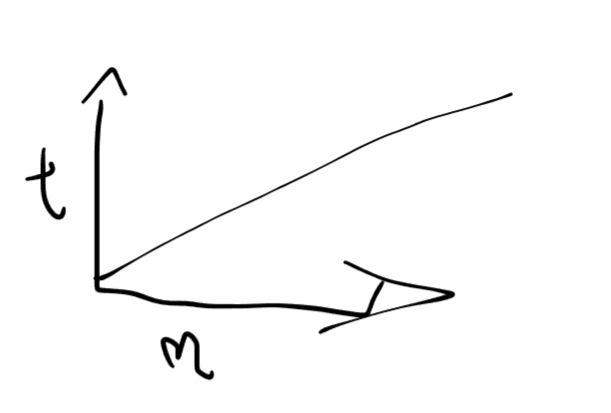
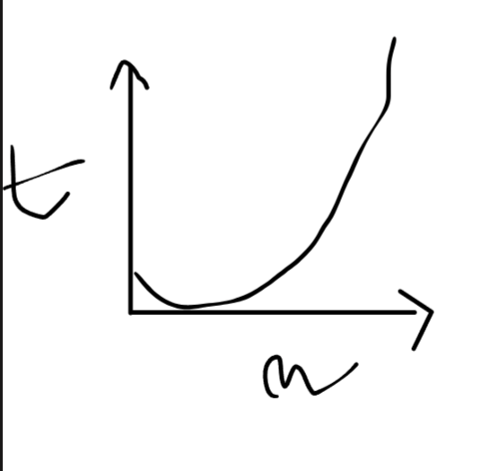

# Lab2

## Problema 1
    A=1,2,3,...,n
    B=1,2,3,...,n
----------------------
    C=2,4,6,...,n+n

Cea mai atomica = C[i]=A[i]+B[i]
+ e cea mai atomica operatie

heap is volatile 
+ 
+ incercam sa paralelizam
+ Implementam algoritm secvential -> dupa trecem la paralelism

### Sabloane de programare paralela
p=c+1