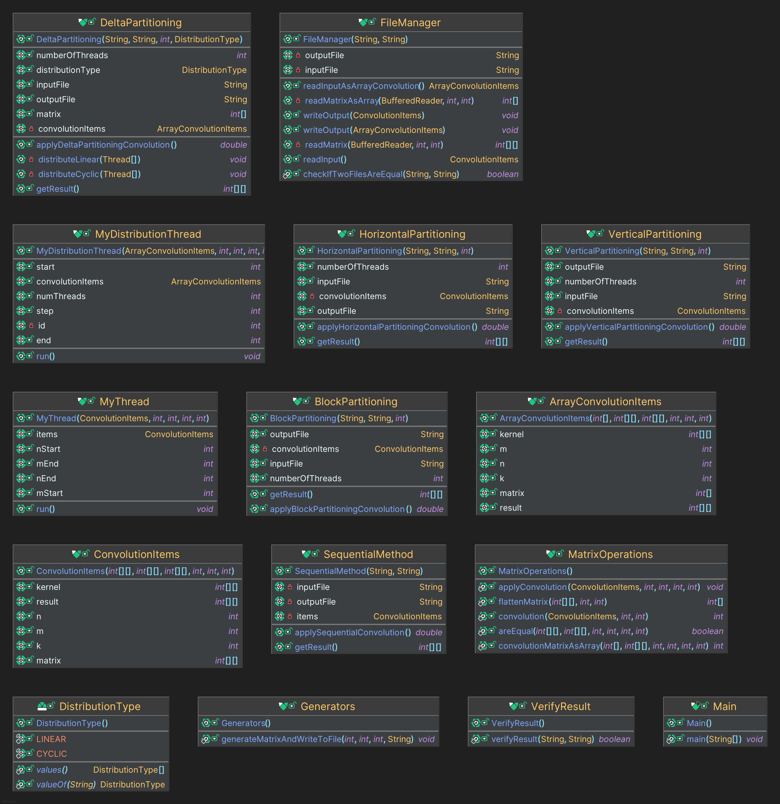

# Analiza asupra convolutiei cu threaduri

## Introducere

### Ce am avut de facut?

- analiza asupra threaduriilor si cum se comporta ele in cadrul unui algoritm de convolutie

### Tehnologii folosite

- C++ cu std::thread
  - static
  - dynamic
- Java cu Thread

### Date intrare:

- N, M - dimensiunile matricei
- matrice de dimensiune N x M
- n, m - dimensiunile kernelului
- kernel de dimensiune n x m

### Teste rulate:

1. N=M=10 si n=m=3; p=4;
2. N=M=1000 si n=m=5; p=2,4,8,16
3. N=10 M=10000 si n=m=5; p=2,4,8,16
4. N=10000 M=10 si n=m=5; p=2,4,8,16
5. N=10000 M=10000 si n=m=5; p=2,4,8,16

### Constrangeri:

- nu pot folosi executori

### Forma tabelelor:

- nume fisier: `date_NxM.txt`

### Structuri de date:

- Ca si structuri de date am folosit clase in C++ si Java
- In Java am folosit int [] si int [][] pentru matrice si kernel
- In C++ am folosit vector<vector<int>> pentru matrice si kernel cand vorbim de dinamic
- In C++ am folosit int[MAX][MAX] pentru matrice si kernel cand vorbim de static
- Folosesc in principal clasele "ConvolutionItems" si "ArrayConvolutionItems" pentru a stoca datele si a le prelucra

### Partitionare pe threaduri:

Am facut toate tipuriile cerute pentru partitionare:

- pe orizontal: adica impartesc matricea dupa linii si dau proportional linii la threads
- pe vertical: adica impartesc matricea dupa coloane si dau proportional coloane la threads
- pe blocuri: adica impartesc matricea in blocuri si dau proportional blocuri la threads (submatrici)
- dupa o functie delta: - liniar: adica consider matricea ca un vector si o impart dupa N\*M/p unde p este numarul de threads
- delta: consider matricea ca un vector si citesc pe sarite adica fiecare thread are elementele astfel: thread 1: 0, p, 2p, 3p, ...; thread 2: 1, p+1, 2p+1, 3p+1, ...; etc
- secvential: adica am un singur thread care face toata treaba

### Clase:

Atat in C++ cat si in Java am aceleasi clase:

- Main: clasa principala care citeste datele si apeleaza metodele de convolutie
- Clase pentru Gestionarea datelor:
  - ConvolutionItems: clasa care contine datele pentru convolutie
  - ArrayConvolutionItems: clasa care contine datele pentru convolutie sub forma de array
- Clase pentru Gestionarea threaduriilor:
  - MyThread:
    - in C++: clasa care contine apelul de convolutie pentru matricea/submatricea data
    - in Java: clasa care extine Thread si contine apelul de convolutie pentru
      matricea/submatricea data
  - MyDistributionThread:
    - in C++: clasa care ajuta la rularea cand vorbim de primirea datelor sub forma de array
    - in Java: clasa care ajuta la rularea cand vorbim de primirea datelor sub forma de array si extinde Thread
- Clase pentru Moduriile de partitionare:
  - SequentialMethod: clasa care face calculul secvential
  - HorizontalPartitioning: clasa care imparte matricea pe orizontala
  - VerticalPartitioning: clasa care imparte matricea pe verticala
  - BlockPartitioning: clasa care imparte matricea in blocuri
  - DeltaPartitioning: clasa care imparte matricea dupa o functie delta
    - primeste un tip de partitionare si un numar de threads
    - in functie de tipul de partitionare apeleaza metoda de partitionare corespunzatoare
- Clase utilitare:
  - Pentru Operatii pe Matrice/Array:
    - MatrixOperations:
      - contine metoda de convolutie
      - contine verificarea daca doua matrici sunt egale
  - Pentru prelucrarea datelor din fisiere:
    - FileManager: clasa care citeste datele din fisier si le pune in clasa ConvolutionItems sau ArrayConvolutionItems
      - contine metode de citire si scriere in fisier
      - verifica daca doua fisiere sunt egale
  - Pentru verificarea corectitudinii:
  - VerifyResult: clasa care verifica daca rezultatele sunt corecte
    

### Functiile claselor:

#### **ConvolutionItems** (Java și C++)

Clasa `ConvolutionItems` conține datele necesare pentru aplicarea convoluției asupra unei matrice și kernel-ului. Aceste date sunt folosite în toate metodele de convoluție.

##### Funcții:

- **Constructor:**
  Inițializează matricea, kernel-ul și rezultatul convoluției.

  ````java
  public ConvolutionItems(int[][] matrix, int[][] kernel, int[][] result, int n, int m, int k);
  ``` - in java
  - in C++ sunt doua definiri de aceea am pus doar una
  - **Parametri:**
    - `matrix`: Matricea de intrare (pe care se va aplica convoluția)
    - `kernel`: Kernel-ul (filtrul) pentru convoluție
    - `result`: Matricea în care se va stoca rezultatul convoluției
    - `n`: Numărul de linii din matricea de intrare
    - `m`: Numărul de coloane din matricea de intrare
    - `k`: Dimensiunea kernel-ului

  ````

- **Funcție de manipulare a datelor:**
  Pe baza implementării, aceste date sunt folosite în cadrul metodei de convoluție din `MatrixOperations`.

---

#### **ArrayConvolutionItems** (Java și C++)

Această clasă este similară cu `ConvolutionItems`, dar matricea de intrare este stocată într-un array unidimensional pentru optimizare și acces mai rapid.

##### Funcții:

- **Constructor:**
  Inițializează matricea ca array, kernel-ul și matricea de rezultat.
  ```java
  public ArrayConvolutionItems(int[] matrix, int[][] kernel, int[][] result, int n, int m, int k);
  ```
  - **Parametri:**
    - `matrix`: Matricea de intrare stocată sub formă de array unidimensional
    - `kernel`: Kernel-ul pentru convoluție
    - `result`: Matricea de rezultat
    - `n`: Numărul de linii
    - `m`: Numărul de coloane
    - `k`: Dimensiunea kernel-ului

---

#### **MyThread** (Java și C++)

Clasa `MyThread` se ocupă cu rularea convoluției pe o submatrice specifică, distribuită între firele de execuție.

##### Funcții:

- **Constructor:**
  Inițializează datele necesare pentru rularea convoluției pe un subset de matrice.

  ```java
  public MyThread(ConvolutionItems items, int nStart, int nEnd, int mStart, int mEnd);
  ```

  - **Parametri:**
    - `items`: Obiectul `ConvolutionItems` care conține datele convoluției
    - `nStart`: Indexul de start pe linii pentru fire
    - `nEnd`: Indexul de final pe linii
    - `mStart`: Indexul de start pe coloane
    - `mEnd`: Indexul de final pe coloane

- in Java extinde Thread

---

#### **MyDistributionThread** (Java și C++)

Clasa `MyDistributionThread` ajută la distribuirea convoluției când datele sunt stocate sub formă de array și se aplică o metodă de împărțire (cyclică sau liniară).

##### Funcții:

- **Constructor:**
  Inițializează thread-ul cu datele necesare pentru distribuirea sarcinilor între fire.

  ```java
  public MyDistributionThread(ArrayConvolutionItems items, int totalThreads, int step, int start, int end, int threadId);
  ```

  - **Parametri:**
    - `items`: Obiectul `ArrayConvolutionItems` cu matricea sub formă de array
    - `totalThreads`: Numărul total de fire
    - `step`: Pasul cu care se distribuie elementele
    - `start`: Indexul de start
    - `end`: Indexul de final
    - `threadId`: ID-ul thread-ului

- in Java extinde Thread

---

#### **HorizontalPartitioning** (Java și C++)

Clasa **HorizontalPartitioning** implementează metoda de convoluție prin împărțirea matricei pe orizontală. Fiecare thread va procesa un anumit număr de linii din matrice.

##### Funcții:

- **Constructor:**
  Inițializează datele necesare pentru împărțirea orizontală a matricii.

  ```java
  public HorizontalPartitioning(String inputFile, String outputFile, int numberOfThreads);
  ```

  - **Parametri:**
    - `inputFile`: Numele fișierului de intrare care conține matricea
    - `outputFile`: Numele fișierului de ieșire pentru rezultat
    - `numberOfThreads`: Numărul de fire de execuție (threads) care vor efectua convoluția

- **applyHorizontalPartitioningConvolution():**
  Aceasta este metoda principală care implementează împărțirea orizontală și gestionează firele de execuție.
  ```java
  public double applyHorizontalPartitioningConvolution();
  ```
  - **Returnează:** Timpul de execuție în milisecunde.
- **getResult():**
  Returnează matricea de rezultat după aplicarea convoluției.
  ```java
  public int[][] getResult();
  ```

---

#### **VerticalPartitioning** (Java și C++)

Clasa **VerticalPartitioning** implementează metoda de convoluție prin împărțirea matricei pe verticală. Fiecare thread va procesa un anumit număr de coloane din matrice.

##### Funcții:

- **Constructor:**
  Inițializează datele necesare pentru împărțirea verticală a matricii.

  ```java
  public VerticalPartitioning(String inputFile, String outputFile, int numberOfThreads);
  ```

  - **Parametri:**
    - `inputFile`: Numele fișierului de intrare care conține matricea
    - `outputFile`: Numele fișierului de ieșire pentru rezultat
    - `numberOfThreads`: Numărul de fire de execuție

- **applyVerticalPartitioningConvolution():**
  Metoda care implementează împărțirea verticală și gestionează firele de execuție.

  ```java
  public double applyVerticalPartitioningConvolution();
  ```

  - **Returnează:** Timpul de execuție în milisecunde.

- **getResult():**
  Returnează matricea de rezultat după aplicarea convoluției.
  ```java
  public int[][] getResult();
  ```

---

#### **BlockPartitioning** (Java și C++)

Clasa **BlockPartitioning** împarte matricea în blocuri de dimensiuni mai mici. Fiecare thread va procesa un bloc al matricei, distribuit proporțional între fire.

##### Funcții:

- **Constructor:**
  Inițializează datele necesare pentru împărțirea matricei în blocuri.

  ```java
  public BlockPartitioning(String inputFile, String outputFile, int numberOfThreads);
  ```

  - **Parametri:**
    - `inputFile`: Numele fișierului de intrare
    - `outputFile`: Numele fișierului de ieșire
    - `numberOfThreads`: Numărul de fire de execuție

- **applyBlockPartitioningConvolution():**
  Metoda care împarte matricea în blocuri și gestionează firele.

  ```java
  public double applyBlockPartitioningConvolution();
  ```

  - **Returnează:** Timpul de execuție în milisecunde.

- **getResult():**
  Returnează matricea de rezultat.
  ```java
  public int[][] getResult();
  ```

---

#### **DeltaPartitioning** (Java și C++)

Clasa **DeltaPartitioning** aplică împărțirea matricei bazată pe un algoritm de distribuție „delta” (ciclic sau liniar). Firele de execuție vor procesa matricea în funcție de această împărțire.

##### Funcții:

- **Constructor:**
  Inițializează parametrii necesari pentru împărțirea tip "delta".

  ```java
  public DeltaPartitioning(String inputFile, String outputFile, int numberOfThreads, DistributionType distributionType);
  ```

  - **Parametri:**
    - `inputFile`: Numele fișierului de intrare
    - `outputFile`: Numele fișierului de ieșire
    - `numberOfThreads`: Numărul de fire de execuție
    - `distributionType`: Tipul de distribuție (`CYCLIC` sau `LINEAR`)

- **applyDeltaPartitioningConvolution():**
  Metoda principală care implementează împărțirea matricei și gestionează firele.

  ```java
  public double applyDeltaPartitioningConvolution();
  ```

  - **Returnează:** Timpul de execuție în milisecunde.

- **getResult():**
  Returnează matricea de rezultat.
  ```java
  public int[][] getResult();
  ```

---

#### **MatrixOperations** (Java și C++)

Clasa **MatrixOperations** conține operațiile de bază pentru convoluție și funcții auxiliare pentru manipularea și verificarea matricilor.

##### Funcții:

- **convolution():**
  Aplicația convoluției asupra unui punct din matrice, folosind kernel-ul.

  ```java
  public static int convolution(ConvolutionItems items, int x, int y);
  ```

  - **Parametri:**
    - `items`: Obiectul `ConvolutionItems` care conține matricea și kernel-ul
    - `x`: Coordonata liniei
    - `y`: Coordonata coloanei
  - **Returnează:** Rezultatul convoluției la poziția `(x, y)`.

- **applyConvolution():**
  Aplicația convoluției pe o submatrice.

  ```java
  public static void applyConvolution(ConvolutionItems items, int nStart, int nEnd, int mStart, int mEnd);
  ```

  - **Parametri:**
    - `items`: Obiectul `ConvolutionItems`
    - `nStart`: Indexul de început pe linii
    - `nEnd`: Indexul de sfârșit pe linii
    - `mStart`: Indexul de început pe coloane
    - `mEnd`: Indexul de sfârșit pe coloane

- **areEqual():**
  Verifică dacă două matrici sunt egale.
  ```java
  public static boolean areEqual(int[][] matrix1, int[][] matrix2, int n, int m, int N, int M);
  ```
  - **Parametri:**
    - `matrix1`, `matrix2`: Cele două matrici de comparat
    - `n`, `m`: Dimensiunile primei matrici
    - `N`, `M`: Dimensiunile celei de-a doua matrici
  - **Returnează:** `true` dacă matricile sunt egale, `false` altfel.

---

#### **FileManager** (Java și C++)

Clasa **FileManager** este responsabilă pentru citirea și scrierea datelor din și în fișiere.

##### Funcții:

- **Constructor:**
  Inițializează obiectul FileManager cu fișierele de intrare și ieșire.

  ```java
  public FileManager(String inputFile, String outputFile);
  ```

- **readInput():**
  Citește matricea și kernel-ul din fișierul de intrare și le încarcă într-un obiect `ConvolutionItems`.

  ```java
  public ConvolutionItems readInput();
  ```

  - in C++ -> are si pentru array

- **readInputAsArrayConvolution()** - > in Java
  Citește matricea și kernel-ul din fișierul de intrare și le încarcă într-un obiect `ArrayConvolutionItems`.

  ```java
  public ArrayConvolutionItems readInputAsArrayConvolution();
  ```

  - **Returnează:** Obiectul `ArrayConvolutionItems` cu datele citite din fișier.

- **writeOutput():**
  Scrie rezultatul convoluției în fișierul de ieșire.

  ```java
  public void writeOutput(ConvolutionItems items);
  ```

  sau

  ```java
  public void writeOutput(ArrayConvolutionItems items);
  ```

  - **Parametri:**
    - `items`: Obiectul care conține rezultatul convoluției

- **checkIfTwoFilesAreEqual():**
  Verifică dacă două fișiere conțin aceleași date.
  ```java
  public static boolean checkIfTwoFilesAreEqual(String file1, String file2);
  ```

---

#### **VerifyResult** (Java și C++)

Clasa **VerifyResult** verifică dacă rezultatele convoluției sunt corecte, comparând rezultatele obținute cu un fișier valid.

##### Funcții:

- **verifyResult():**
  Verifică dacă rezultatele din fișierul de ieșire sunt corecte, comparându-le cu un fișier valid.
  ```java
  public static boolean verifyResult(String inputFile, String outputFile);
  ```
  - **Parametri:**
    - `inputFile`: Fișierul de intrare
    - `outputFile`: Fișierul de ieșire (rezultatul convoluției)
  - **Returnează:** `true` dacă rezultatele sunt corecte, `false` altfel.

---

####

### Rezultate:

#### Comparare C++ static cu C++ dinamic

Propun sa vedem direct diferenta dintre cele doua metode de a crea threaduri in C++.
| File | NumberOfThreads | PartitionType | StaticTime | DynamicTime | Difference | AbsDifference |
| ------------------- | --------------- | ------------- | ------------- | ----------- | -------------------- | ------------------- |
| date10x10.txt | 4 | sequential | StackOverflow | 0.0 | 0.0 | 0.0 |
| date10x10.txt | 4 | horizontal | 1.3683 | 1.04778 | 0.32052000000000014 | 0.32052000000000014 |
| date10x10.txt | 4 | vertical | 1.41759 | 0.97384 | 0.44374999999999987 | 0.44374999999999987 |
| date10x10.txt | 4 | block | 1.34017 | 0.97279 | 0.36738000000000004 | 0.36738000000000004 |
| date10x10.txt | 4 | linear | 1.56024 | 1.11065 | 0.44959000000000016 | 0.44959000000000016 |
| date10x10.txt | 4 | cyclic | 1.43329 | 1.00892 | 0.4243699999999999 | 0.4243699999999999 |
| date1000x1000.txt | 2 | sequential | 116.4 | 173.4 | -57.0 | 57.0 |
| date1000x1000.txt | 2 | horizontal | 58.13079 | 97.04014 | -38.909349999999996 | 38.909349999999996 |
| date1000x1000.txt | 2 | vertical | 60.58627 | 106.08262 | -45.49635000000001 | 45.49635000000001 |
| date1000x1000.txt | 2 | block | 46.53646 | 60.54911 | -14.01265 | 14.01265 |
| date1000x1000.txt | 2 | linear | 67.29911 | 91.42167 | -24.122560000000007 | 24.122560000000007 |
| date1000x1000.txt | 2 | cyclic | 62.22432 | 90.72342 | -28.499100000000006 | 28.499100000000006 |
| date1000x1000.txt | 4 | horizontal | 33.19655 | 63.08092 | -29.884369999999997 | 29.884369999999997 |
| date1000x1000.txt | 4 | vertical | 35.07388 | 60.70939 | -25.635509999999996 | 25.635509999999996 |
| date1000x1000.txt | 4 | block | 31.81388 | 63.97418 | -32.16029999999999 | 32.16029999999999 |
| date1000x1000.txt | 4 | linear | 38.0802 | 52.54955 | -14.469350000000006 | 14.469350000000006 |
| date1000x1000.txt | 4 | cyclic | 36.02956 | 52.75857 | -16.729010000000002 | 16.729010000000002 |
| date1000x1000.txt | 8 | horizontal | 25.54046 | 58.82502 | -33.28456 | 33.28456 |
| date1000x1000.txt | 8 | vertical | 27.84835 | 42.51215 | -14.663799999999998 | 14.663799999999998 |
| date1000x1000.txt | 8 | block | 20.50895 | 33.06331 | -12.554360000000003 | 12.554360000000003 |
| date1000x1000.txt | 8 | linear | 31.69048 | 31.60078 | 0.08970000000000056 | 0.08970000000000056 |
| date1000x1000.txt | 8 | cyclic | 29.50214 | 32.81242 | -3.3102800000000023 | 3.3102800000000023 |
| date1000x1000.txt | 16 | horizontal | 20.92686 | 30.3774 | -9.45054 | 9.45054 |
| date1000x1000.txt | 16 | vertical | 20.39796 | 27.82361 | -7.425649999999997 | 7.425649999999997 |
| date1000x1000.txt | 16 | block | 22.34153 | 27.42657 | -5.085040000000003 | 5.085040000000003 |
| date1000x1000.txt | 16 | linear | 24.85021 | 26.35244 | -1.5022300000000008 | 1.5022300000000008 |
| date1000x1000.txt | 16 | cyclic | 20.60588 | 25.80123 | -5.195350000000001 | 5.195350000000001 |
| date10x10000.txt | 2 | sequential | 11.2 | 20.8 | -9.600000000000001 | 9.600000000000001 |
| date10x10000.txt | 2 | horizontal | 7.79833 | 12.69747 | -4.899139999999999 | 4.899139999999999 |
| date10x10000.txt | 2 | vertical | 6.90878 | 11.30197 | -4.393190000000001 | 4.393190000000001 |
| date10x10000.txt | 2 | block | 4.68907 | 5.90445 | -1.2153799999999997 | 1.2153799999999997 |
| date10x10000.txt | 2 | linear | 8.08945 | 10.68137 | -2.59192 | 2.59192 |
| date10x10000.txt | 2 | cyclic | 8.14815 | 9.98749 | -1.83934 | 1.83934 |
| date10x10000.txt | 4 | horizontal | 4.99749 | 7.68544 | -2.68795 | 2.68795 |
| date10x10000.txt | 4 | vertical | 4.40623 | 6.03242 | -1.6261900000000002 | 1.6261900000000002 |
| date10x10000.txt | 4 | block | 5.01065 | 6.89843 | -1.8877800000000002 | 1.8877800000000002 |
| date10x10000.txt | 4 | linear | 5.18442 | 5.94663 | -0.7622099999999996 | 0.7622099999999996 |
| date10x10000.txt | 4 | cyclic | 5.1016 | 5.52325 | -0.42164999999999964 | 0.42164999999999964 |
| date10x10000.txt | 8 | horizontal | 4.34789 | 5.80325 | -1.4553600000000007 | 1.4553600000000007 |
| date10x10000.txt | 8 | vertical | 4.73467 | 4.57511 | 0.1595600000000008 | 0.1595600000000008 |
| date10x10000.txt | 8 | block | 4.4799 | 5.13295 | -0.6530500000000004 | 0.6530500000000004 |
| date10x10000.txt | 8 | linear | 4.70726 | 4.29614 | 0.4111199999999995 | 0.4111199999999995 |
| date10x10000.txt | 8 | cyclic | 5.4891 | 4.4414 | 1.0476999999999999 | 1.0476999999999999 |
| date10x10000.txt | 16 | horizontal | 4.62014 | 5.35643 | -0.7362899999999994 | 0.7362899999999994 |
| date10x10000.txt | 16 | vertical | 4.61343 | 4.53114 | 0.08229000000000042 | 0.08229000000000042 |
| date10x10000.txt | 16 | block | 5.21067 | 5.01259 | 0.19808000000000003 | 0.19808000000000003 |
| date10x10000.txt | 16 | linear | 4.53139 | 4.2848 | 0.2465900000000003 | 0.2465900000000003 |
| date10x10000.txt | 16 | cyclic | 4.605 | 3.93932 | 0.6656800000000005 | 0.6656800000000005 |
| date10000x10.txt | 2 | sequential | 10.9 | 21.0 | -10.1 | 10.1 |
| date10000x10.txt | 2 | horizontal | 7.43278 | 11.304 | -3.87122 | 3.87122 |
| date10000x10.txt | 2 | vertical | 7.21573 | 10.68539 | -3.46966 | 3.46966 |
| date10000x10.txt | 2 | block | 4.69343 | 6.10289 | -1.4094600000000002 | 1.4094600000000002 |
| date10000x10.txt | 2 | linear | 8.00169 | 9.94513 | -1.9434400000000007 | 1.9434400000000007 |
| date10000x10.txt | 2 | cyclic | 7.98432 | 10.27999 | -2.2956699999999994 | 2.2956699999999994 |
| date10000x10.txt | 4 | horizontal | 4.6085 | 6.5308 | -1.9223 | 1.9223 |
| date10000x10.txt | 4 | vertical | 4.93194 | 6.78463 | -1.85269 | 1.85269 |
| date10000x10.txt | 4 | block | 4.92879 | 6.31224 | -1.3834499999999998 | 1.3834499999999998 |
| date10000x10.txt | 4 | linear | 5.36537 | 5.89539 | -0.5300199999999995 | 0.5300199999999995 |
| date10000x10.txt | 4 | cyclic | 5.36591 | 5.58634 | -0.22042999999999946 | 0.22042999999999946 |
| date10000x10.txt | 8 | horizontal | 4.89587 | 4.67895 | 0.21692 | 0.21692 |
| date10000x10.txt | 8 | vertical | 4.55117 | 5.13501 | -0.5838400000000004 | 0.5838400000000004 |
| date10000x10.txt | 8 | block | 5.23147 | 5.08707 | 0.14440000000000008 | 0.14440000000000008 |
| date10000x10.txt | 8 | linear | 4.8903 | 4.60985 | 0.2804500000000001 | 0.2804500000000001 |
| date10000x10.txt | 8 | cyclic | 4.98633 | 4.26893 | 0.7173999999999996 | 0.7173999999999996 |
| date10000x10.txt | 16 | horizontal | 4.7936 | 4.21432 | 0.5792799999999998 | 0.5792799999999998 |
| date10000x10.txt | 16 | vertical | 4.32835 | 4.96765 | -0.6392999999999995 | 0.6392999999999995 |
| date10000x10.txt | 16 | linear | 5.42034 | 3.73917 | 1.6811700000000003 | 1.6811700000000003 |
| date10000x10.txt | 16 | cyclic | 5.27635 | 4.34108 | 0.93527 | 0.93527 |
| date10000x10000.txt | 2 | sequential | StackOverflow | 16651.0 | 0 | 0 |
| date10000x10000.txt | 2 | horizontal | StackOverflow | 8768.913 | 0 | 0 |
| date10000x10000.txt | 2 | vertical | StackOverflow | 8717.726 | 0 | 0 |
| date10000x10000.txt | 2 | block | StackOverflow | 4826.054 | 0 | 0 |
| date10000x10000.txt | 2 | linear | StackOverflow | 7909.633 | 0 | 0 |
| date10000x10000.txt | 2 | cyclic | StackOverflow | 7861.844 | 0 | 0 |
| date10000x10000.txt | 4 | horizontal | StackOverflow | 4854.574 | 0 | 0 |
| date10000x10000.txt | 4 | vertical | StackOverflow | 4836.857 | 0 | 0 |
| date10000x10000.txt | 4 | block | StackOverflow | 4848.587 | 0 | 0 |
| date10000x10000.txt | 4 | linear | StackOverflow | 4289.954 | 0 | 0 |
| date10000x10000.txt | 4 | cyclic | StackOverflow | 4195.42 | 0 | 0 |
| date10000x10000.txt | 8 | horizontal | StackOverflow | 2817.28 | 0 | 0 |
| date10000x10000.txt | 8 | vertical | StackOverflow | 2796.033 | 0 | 0 |
| date10000x10000.txt | 8 | block | StackOverflow | 2683.058 | 0 | 0 |
| date10000x10000.txt | 8 | linear | StackOverflow | 2492.534 | 0 | 0 |
| date10000x10000.txt | 8 | cyclic | StackOverflow | 2527.221 | 0 | 0 |
| date10000x10000.txt | 16 | horizontal | StackOverflow | 1896.998 | 0 | 0 |
| date10000x10000.txt | 16 | vertical | StackOverflow | 1879.604 | 0 | 0 |
| date10000x10000.txt | 16 | block | StackOverflow | 1877.171 | 0 | 0 |
| date10000x10000.txt | 16 | linear | StackOverflow | 1776.2 | 0 | 0 |
| date10000x10000.txt | 16 | cyclic | StackOverflow | 1785.213 | 0 | 0 |

Se vede clar ca metoda statica este mai rapida decat cea dinamica, dar aceasta din urma este mai flexibila si poate fi folosita in mai multe cazuri. Problema este ca pe static stack ul are intre 1 MB si 8MB (cu compilare speciala) si daca se depaseste aceasta limita, programul va crapa. Dinamica nu are aceasta problema, dar este mai lenta.

#### Comparare C++ cu Java

O diferenta uriasa la timpii de citire si scriere a fisierelor. O sa adaug la sfarsit timpul la fisierele de 10000x10000 cu comparatia dintre C++ si Java.

O sa pun un tabel cu diferentele!

#### Analiza

Se poate observa ca Java este mult mai lent decat C++ atat static cat si dinamic daca vorbim de date mai mici. In momentul in care vorbim de date mai mari in cazul de 10000x10000 putem observa ca Java a fost mai rapid decat C++ diferenta fiind destul de mare.
De asemenea, in cazul Java citirea este mai rapida. Din cate am citit e din cauza ca am folosit ifstream si ofstream in C++ care sunt mai lente decat cele din Java . ifstream citeste cuvant cu cuvant si ofstream scrie cuvant cu cuvant, in timp ce cele din Java citesc si scriu linie cu linie.

| File                | NumberOfThreads | PartitionType | JavaTime  | CStaticTime | CDynamicTime | DifferenceStatic    | DifferenceDynamic |
| ------------------- | --------------- | ------------- | --------- | ----------- | ------------ | ------------------- | ----------------- |
| date10x10.txt       | 4               | sequential    | 1.1403    | 0.0000      | 0.0000       | -1.14033            | -1.1403           |
| date10x10.txt       | 4               | horizontal    | 2.1252    | 1.3683      | 1.0478       | -0.7568600000000001 | -1.0774           |
| date10x10.txt       | 4               | vertical      | 2.4103    | 1.4176      | 0.9738       | -0.9926800000000002 | -1.4364           |
| date10x10.txt       | 4               | block         | 2.1915    | 1.3402      | 0.9728       | -0.8513699999999997 | -1.2187           |
| date10x10.txt       | 4               | linear        | 2.9688    | 1.5602      | 1.1106       | -1.40858            | -1.8582           |
| date10x10.txt       | 4               | cyclic        | 3.4119    | 1.4333      | 1.0089       | -1.9786299999999999 | -2.4030           |
| date1000x1000.txt   | 2               | sequential    | 43.6416   | 116.4000    | 173.4000     | 72.75840000000001   | 129.7584          |
| date1000x1000.txt   | 2               | horizontal    | 58.6599   | 58.1308     | 97.0401      | -0.5290800000000004 | 38.3803           |
| date1000x1000.txt   | 2               | vertical      | 47.3314   | 60.5863     | 106.0826     | 13.254849999999998  | 58.7512           |
| date1000x1000.txt   | 2               | block         | 44.2138   | 46.5365     | 60.5491      | 2.3226799999999983  | 16.3353           |
| date1000x1000.txt   | 2               | linear        | 43.9057   | 67.2991     | 91.4217      | 23.393459999999997  | 47.5160           |
| date1000x1000.txt   | 2               | cyclic        | 47.6870   | 62.2243     | 90.7234      | 14.537369999999996  | 43.0365           |
| date1000x1000.txt   | 4               | horizontal    | 61.0974   | 33.1966     | 63.0809      | -27.90086           | 1.9835            |
| date1000x1000.txt   | 4               | vertical      | 51.5425   | 35.0739     | 60.7094      | -16.468629999999997 | 9.1669            |
| date1000x1000.txt   | 4               | block         | 45.6018   | 31.8139     | 63.9742      | -13.787939999999995 | 18.3724           |
| date1000x1000.txt   | 4               | linear        | 46.1275   | 38.0802     | 52.5496      | -8.0473             | 6.4221            |
| date1000x1000.txt   | 4               | cyclic        | 47.1586   | 36.0296     | 52.7586      | -11.129010000000001 | 5.6000            |
| date1000x1000.txt   | 8               | horizontal    | 105.9171  | 25.5405     | 58.8250      | -80.37665           | -47.0921          |
| date1000x1000.txt   | 8               | vertical      | 89.7756   | 27.8483     | 42.5121      | -61.92727000000001  | -47.2635          |
| date1000x1000.txt   | 8               | block         | 173.4556  | 20.5089     | 33.0633      | -152.94669          | -140.3923         |
| date1000x1000.txt   | 8               | linear        | 111.9101  | 31.6905     | 31.6008      | -80.21965           | -80.3093          |
| date1000x1000.txt   | 8               | cyclic        | 77.2601   | 29.5021     | 32.8124      | -47.75798           | -44.4477          |
| date1000x1000.txt   | 16              | horizontal    | 112.4242  | 20.9269     | 30.3774      | -91.49732999999999  | -82.0468          |
| date1000x1000.txt   | 16              | vertical      | 89.4792   | 20.3980     | 27.8236      | -69.08121           | -61.6556          |
| date1000x1000.txt   | 16              | block         | 95.6941   | 22.3415     | 27.4266      | -73.35262           | -68.2676          |
| date1000x1000.txt   | 16              | linear        | 76.8381   | 24.8502     | 26.3524      | -51.987849999999995 | -50.4856          |
| date1000x1000.txt   | 16              | cyclic        | 79.9096   | 20.6059     | 25.8012      | -59.303700000000006 | -54.1084          |
| date10x10000.txt    | 2               | sequential    | 28.2655   | 11.2000     | 20.8000      | -17.06546           | -7.4655           |
| date10x10000.txt    | 2               | horizontal    | 45.6788   | 7.7983      | 12.6975      | -37.88043           | -32.9813          |
| date10x10000.txt    | 2               | vertical      | 45.1541   | 6.9088      | 11.3020      | -38.24532           | -33.8521          |
| date10x10000.txt    | 2               | block         | 52.1880   | 4.6891      | 5.9044       | -47.49888           | -46.2835          |
| date10x10000.txt    | 2               | linear        | 34.8813   | 8.0894      | 10.6814      | -26.7919            | -24.2000          |
| date10x10000.txt    | 2               | cyclic        | 35.5850   | 8.1481      | 9.9875       | -27.43687           | -25.5975          |
| date10x10000.txt    | 4               | horizontal    | 44.7217   | 4.9975      | 7.6854       | -39.72417           | -37.0362          |
| date10x10000.txt    | 4               | vertical      | 49.8886   | 4.4062      | 6.0324       | -45.482369999999996 | -43.8562          |
| date10x10000.txt    | 4               | block         | 47.1927   | 5.0107      | 6.8984       | -42.18208           | -40.2943          |
| date10x10000.txt    | 4               | linear        | 44.5574   | 5.1844      | 5.9466       | -39.372989999999994 | -38.6108          |
| date10x10000.txt    | 4               | cyclic        | 50.5864   | 5.1016      | 5.5232       | -45.484790000000004 | -45.0631          |
| date10x10000.txt    | 8               | horizontal    | 68.9186   | 4.3479      | 5.8033       | -64.57076           | -63.1154          |
| date10x10000.txt    | 8               | vertical      | 47.4278   | 4.7347      | 4.5751       | -42.6931            | -42.8527          |
| date10x10000.txt    | 8               | block         | 48.2001   | 4.4799      | 5.1330       | -43.72018           | -43.0671          |
| date10x10000.txt    | 8               | linear        | 47.9481   | 4.7073      | 4.2961       | -43.24085           | -43.6520          |
| date10x10000.txt    | 8               | cyclic        | 50.2928   | 5.4891      | 4.4414       | -44.80374           | -45.8514          |
| date10x10000.txt    | 16              | horizontal    | 54.5149   | 4.6201      | 5.3564       | -49.89475           | -49.1585          |
| date10x10000.txt    | 16              | vertical      | 53.4148   | 4.6134      | 4.5311       | -48.80136           | -48.8837          |
| date10x10000.txt    | 16              | block         | 60.3568   | 5.2107      | 5.0126       | -55.14614           | -55.3442          |
| date10x10000.txt    | 16              | linear        | 35.9160   | 4.5314      | 4.2848       | -31.38458           | -31.6312          |
| date10x10000.txt    | 16              | cyclic        | 55.0165   | 4.6050      | 3.9393       | -50.411469999999994 | -51.0771          |
| date10000x10.txt    | 2               | sequential    | 19.6542   | 10.9000     | 21.0000      | -8.75416            | 1.3458            |
| date10000x10.txt    | 2               | horizontal    | 26.1594   | 7.4328      | 11.3040      | -18.72667           | -14.8554          |
| date10000x10.txt    | 2               | vertical      | 33.6827   | 7.2157      | 10.6854      | -26.466929999999998 | -22.9973          |
| date10000x10.txt    | 2               | block         | 45.3952   | 4.6934      | 6.1029       | -40.70181           | -39.2923          |
| date10000x10.txt    | 2               | linear        | 45.5352   | 8.0017      | 9.9451       | -37.533519999999996 | -35.5901          |
| date10000x10.txt    | 2               | cyclic        | 33.9901   | 7.9843      | 10.2800      | -26.00576           | -23.7101          |
| date10000x10.txt    | 4               | horizontal    | 42.9400   | 4.6085      | 6.5308       | -38.33152           | -36.4092          |
| date10000x10.txt    | 4               | vertical      | 59.6125   | 4.9319      | 6.7846       | -54.680550000000004 | -52.8279          |
| date10000x10.txt    | 4               | block         | 65.6703   | 4.9288      | 6.3122       | -60.741490000000006 | -59.3580          |
| date10000x10.txt    | 4               | linear        | 58.2127   | 5.3654      | 5.8954       | -52.84736           | -52.3173          |
| date10000x10.txt    | 4               | cyclic        | 70.5889   | 5.3659      | 5.5863       | -65.22297           | -65.0025          |
| date10000x10.txt    | 8               | horizontal    | 158.6822  | 4.8959      | 4.6790       | -153.78635          | -154.0033         |
| date10000x10.txt    | 8               | vertical      | 186.6479  | 4.5512      | 5.1350       | -182.09675          | -181.5129         |
| date10000x10.txt    | 8               | block         | 155.5997  | 5.2315      | 5.0871       | -150.36823          | -150.5126         |
| date10000x10.txt    | 8               | linear        | 142.5760  | 4.8903      | 4.6098       | -137.68572          | -137.9662         |
| date10000x10.txt    | 8               | cyclic        | 49.6768   | 4.9863      | 4.2689       | -44.69048           | -45.4079          |
| date10000x10.txt    | 16              | horizontal    | 36.1489   | 4.7936      | 4.2143       | -31.355310000000003 | -31.9346          |
| date10000x10.txt    | 16              | vertical      | 37.5645   | 4.3284      | 4.9676       | -33.2361            | -32.5968          |
| date10000x10.txt    | 16              | block         | 39.7460   | 9.3247      | 6.5795       | -30.421269999999996 | -33.1665          |
| date10000x10.txt    | 16              | linear        | 32.8187   | 5.4203      | 3.7392       | -27.39838           | -29.0795          |
| date10000x10.txt    | 16              | cyclic        | 41.4452   | 5.2763      | 4.3411       | -36.168839999999996 | -37.1041          |
| date10000x10000.txt | 2               | sequential    | 2614.3372 | N/A         | 16651.0000   | N/A                 | 14036.6628        |
| date10000x10000.txt | 2               | horizontal    | 1360.8465 | N/A         | 8768.9130    | N/A                 | 7408.0665         |
| date10000x10000.txt | 2               | vertical      | 1381.5358 | N/A         | 8717.7260    | N/A                 | 7336.1902         |
| date10000x10000.txt | 2               | block         | 702.3831  | N/A         | 4826.0540    | N/A                 | 4123.6709         |
| date10000x10000.txt | 2               | linear        | 1571.6339 | N/A         | 7909.6330    | N/A                 | 6337.9991         |
| date10000x10000.txt | 2               | cyclic        | 1565.2698 | N/A         | 7861.8440    | N/A                 | 6296.5742         |
| date10000x10000.txt | 4               | horizontal    | 727.2670  | N/A         | 4854.5740    | N/A                 | 4127.3070         |
| date10000x10000.txt | 4               | vertical      | 714.3949  | N/A         | 4836.8570    | N/A                 | 4122.4621         |
| date10000x10000.txt | 4               | block         | 714.9145  | N/A         | 4848.5870    | N/A                 | 4133.6725         |
| date10000x10000.txt | 4               | linear        | 896.9753  | N/A         | 4289.9540    | N/A                 | 3392.9787         |
| date10000x10000.txt | 4               | cyclic        | 889.5009  | N/A         | 4195.4200    | N/A                 | 3305.9191         |
| date10000x10000.txt | 8               | horizontal    | 539.4715  | N/A         | 2817.2800    | N/A                 | 2277.8085         |
| date10000x10000.txt | 8               | vertical      | 545.9324  | N/A         | 2796.0330    | N/A                 | 2250.1006         |
| date10000x10000.txt | 8               | block         | 542.8263  | N/A         | 2683.0580    | N/A                 | 2140.2317         |
| date10000x10000.txt | 8               | linear        | 648.0821  | N/A         | 2492.5340    | N/A                 | 1844.4519         |
| date10000x10000.txt | 8               | cyclic        | 770.5850  | N/A         | 2527.2210    | N/A                 | 1756.6360         |
| date10000x10000.txt | 16              | horizontal    | 479.9715  | N/A         | 1896.9980    | N/A                 | 1417.0265         |
| date10000x10000.txt | 16              | vertical      | 479.3983  | N/A         | 1879.6040    | N/A                 | 1400.2057         |
| date10000x10000.txt | 16              | block         | 476.3724  | N/A         | 1877.1710    | N/A                 | 1400.7986         |
| date10000x10000.txt | 16              | linear        | 563.7132  | N/A         | 1776.2000    | N/A                 | 1212.4868         |
| date10000x10000.txt | 16              | cyclic        | 592.8688  | N/A         | 1785.2130    | N/A                 | 1192.3442         |
