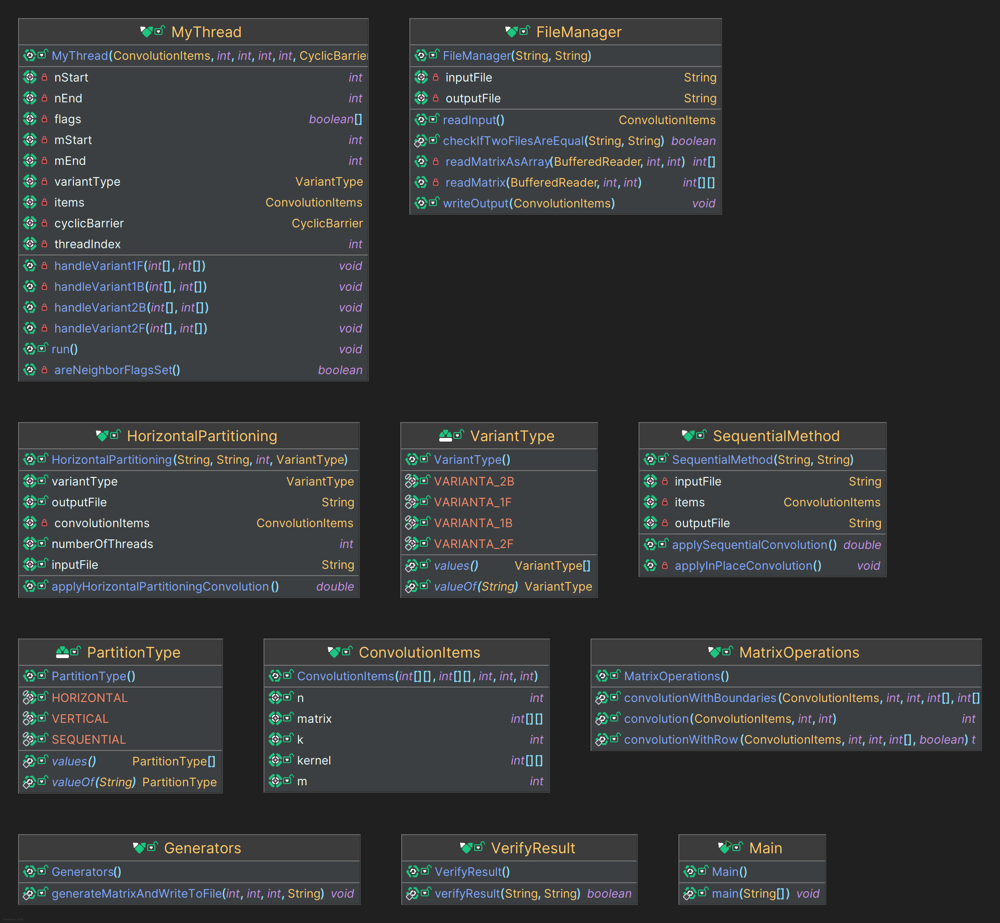

# Laboratorul 2 - Optimizarea complexității spatiului pentru Laboratorul 1

## Introducere

### Ce am avut de făcut?

- de a optimiza complexitatea spațiului a algoritmului de convolutie de la laboratorul 1
- trebuia sa folosim una sau mai multe dintre variantele descrise in fisierul Lab2_utils.docx.
- se salveaza rezultatul direct in matricea citita fara o matrice auxiliara

### Restrictii:

- nu mai avem o matrice care tine rezultatul convolutiei

### Abordare:

- am implementat doua variante:
  - varianta 1_b: folosind bariere pentru sincronizare
  - varianta 1_f: folosind flags pentru sincronizare
- la varianta 1:
  - retinem frontierele cu celelalte thread-uri, pentru ca exista riscul sa fie schimbate inainte sa le accesam
  - pentru fiecare rand din submatricea unui thread retinem forma initiala
- la secventiala:
  - am doi vectori ->
    - unul pentru randul curent - convolutia randului curent
    - unul pentru randul anterior - convolutia randului anterior
  - la fiecare pas, randul anterior devine randul curent
  - si salvez rezultatul de la randul anterior dupa ce am computat la randul curent convolutia

### Complexitatea spatiului:

- pentru fiecare thread retinem frontierele si forma initiala a randului
- retinem si randul curent (O(m) - unde m este numarul de coloane)
- astfel pentru fiecare thread complexitatea este O(m)
- complexitatea totala este O(m \* p) - unde p este numarul de threaduri

### Tehnologii folosite:

- C++ 23:
  - dynamic cu vectori (std::vector)
  - thread-uri (std::thread)
  - barrier (std::barrier)
- Java:
  - dynamic cu vectori primitivi (int[])
  - thread-uri (Thread)
  - CyclicBarrier

### Teste rulate:

    - N=M=10 si n=m=3; p=2 +executie secventiala
    - N=M=1000 si n=m=3; p=2,4,8,16 +executie secventiala
    - N=10000 M=10000 si n=m=3; p=2,4,8,16+executie secventiala

### Date intrare:

- N, M - dimensiunile matricei
- matrice de dimensiune N x M
- n, m - dimensiunile kernelului
- kernel de dimensiune n x m

### Structuri de date

In Java am folosit int [] si int [][] pentru matrice si kernel
In C++ am folosit vector<vector> pentru matrice si kernel cand vorbim de dinamic
Folosesc in principal clasele "ConvolutionItems" pentru a stoca datele si a le prelucra

### Partitionarea pe threaduri

Am facut Partitionarea pe orizontala:

- fiecare thread primeste un numar de linii egal cu N/p sau N/p + 1

### Clase

Am sters fata de laboratorul I din clasele pe care nu le mai folosesc, dar structura a ramas astfel:

- Main: clasa principala care citeste datele si apeleaza metodele de convolutie
- Clasa pentru Gestionarea datelor:
  - ConvolutionItems: clasa care contine datele pentru convolutie
- Clasa pentru thread:
  - My thread:
    - in C++: clasa care contine apelul de convolutie pentru matricea/submatricea data
    - in Java: clasa care extine Thread si contine apelul de convolutie pentru matricea/submatricea data
- Clase pentru Moduriile de partitionare:
  - SequentialMethod: clasa care face calculul secvential
  - HorizontalPartitioning: clasa care imparte matricea pe orizontala
- Clase utilitare:
  - MatrixOperations:
    - contine metode de convolutie - pentru diferite formate
- Pentru prelucrarea datelor din fisiere:
  - FileManager: clasa care citeste datele din fisier si le pune in clasa ConvolutionItems sau ArrayConvolutionItems
    - contine metode de citire si scriere in fisier
    - verifica daca doua fisiere sunt egale
- Pentru verificarea corectitudinii:
  - VerifyResult: clasa care verifica daca rezultatele sunt corecte



### Functii

#### **ConvolutionItems** (Java+C++)

Această clasă definește structura de date pentru convoluție și stochează matricea, kernel-ul și dimensiunile acestora.

- implementarea in C++ este cu vectori de vectori (singura diferenta)

##### Funcții:

- **Constructor**:
  ```java
  public ConvolutionItems(int[][] matrix, int[][] kernel, int n, int m, int k);
  ```
  - **Parametri**:
    - `matrix`: Matricea de intrare
    - `kernel`: Kernel-ul pentru convoluție
    - `n`: Numărul de linii
    - `m`: Numărul de coloane
    - `k`: Dimensiunea kernel-ului

---

#### **FileManager** (Java)

Clasa `FileManager` este responsabilă pentru citirea și scrierea datelor în și din fișiere.

##### Funcții:

- **readInput()**:
  Citește matricea și kernel-ul din fișierul de intrare.

  ```java
  public ConvolutionItems readInput();
  ```

- **writeOutput()**:
  Scrie rezultatul convoluției în fișierul de ieșire.

  ```java
  public void writeOutput(ConvolutionItems convolutionItems);
  ```

- **checkIfTwoFilesAreEqual()**:
  Verifică dacă două fișiere conțin aceleași date.
  ```java
  public static boolean checkIfTwoFilesAreEqual(String file1, String file2);
  ```

---

#### **MatrixOperations** (Java)

Clasa `MatrixOperations` conține metodele de bază pentru realizarea convoluției.

##### Funcții:

- **convolution()**:
  Realizează convoluția pentru un punct specificat.

  ```java
  public static int convolution(ConvolutionItems convolutionItems, int x, int y);
  ```

- **convolutionWithRow()**:
  Aplicația convoluției folosind o linie de margine specifică.

  ```java
  public static int convolutionWithRow(ConvolutionItems items, int x, int y, int[] row, boolean isTopRow);
  ```

- **convolutionWithBoundaries()**:
  Realizează convoluția luând în considerare valorile marginii de sus, centru și marginea de jos, pentru a gestiona margini specifice ale matricii.
  ```java
  public static int convolutionWithBoundaries(ConvolutionItems items, int x, int y, int[] tRow, int[] cRow, int[] bRow, boolean isLastRow);
  ```

---

#### **VerifyResult** (Java)

Clasa `VerifyResult` verifică dacă rezultatele convoluției sunt corecte prin compararea cu un fișier valid.

##### Funcții:

- **verifyResult()**:
  Compară fișierul de ieșire generat cu un fișier de referință valid.
  ```java
  public static boolean verifyResult(String inputFile, String outputFile);
  ```

---

#### **MyThread** (Java)

Clasa `MyThread` rulează convoluția pe submatricea specificată folosind diverse variante de sincronizare între fire: bariere (`CyclicBarrier`) și semafoare (`flags`).

##### Funcții:

- **Constructor**:

  ```java
  public MyThread(ConvolutionItems items, int nStart, int nEnd, int mStart, int mEnd, CyclicBarrier cyclicBarrier, VariantType variantType, boolean[] flags, int threadIndex);
  ```

  - **Parametri**:
    - `items`: Obiectul `ConvolutionItems` cu matricea și kernel-ul
    - `nStart`, `nEnd`: Intervalul de linii procesate de acest thread
    - `mStart`, `mEnd`: Intervalul de coloane procesate de acest thread
    - `cyclicBarrier`: Bariera pentru sincronizare (utilizată în variantele `1B` și `2B`)
    - `variantType`: Tipul de variantă (`VARIANTA_1B`, `VARIANTA_1F`, `VARIANTA_2B`, `VARIANTA_2F`)
    - `flags`: Semaforul de sincronizare între fire (pentru variantele `1F` și `2F`)
    - `threadIndex`: Indexul thread-ului pentru gestionarea sincronizării

- **run()**:
  Funcția principală care rulează convoluția pe baza tipului de variantă.

- **handleVariant1B()**:
  Aplicația convoluției cu o barieră pentru sincronizare (varianta 1).

  ```java
  private void handleVariant1B(int[] topRow, int[] bottomRow) throws BrokenBarrierException, InterruptedException;
  ```

- **handleVariant1F()**:
  Aplicația convoluției folosind semafoare pentru sincronizare (varianta 1).

  ```java
  private void handleVariant1F(int[] topRow, int[] bottomRow);
  ```

- **handleVariant2B()**:
  Aplicația convoluției cu o barieră și gestiune a valorilor de margine (varianta 2).

  ```java
  private void handleVariant2B(int[] topRow, int[] bottomRow) throws InterruptedException, BrokenBarrierException;
  ```

- **handleVariant2F()**:
  Aplicația convoluției folosind semafoare pentru sincronizare și gestionarea valorilor de margine (varianta 2).

  ```java
  private void handleVariant2F(int[] topRow, int[] bottomRow) throws InterruptedException, BrokenBarrierException;
  ```

- **areNeighborFlagsSet()**:
  Verifică dacă firele vecine au setat semafoarele, necesar pentru variantele `1F` și `2F`.
  ```java
  private boolean areNeighborFlagsSet();
  ```

---

#### **SequentialMethod** (Java)

Clasa `SequentialMethod` implementează convoluția într-o manieră secvențială, fără utilizarea firelor de execuție.

##### Funcții:

- **Constructor**:

  ```java
  public SequentialMethod(String inputFile, String outputFile);
  ```

  - **Parametri**:
    - `inputFile`: Fișierul de intrare cu matricea
    - `outputFile`: Fișierul de ieșire pentru rezultat

- **applySequentialConvolution()**:
  Metoda principală care aplică convoluția secvențială pe întreaga matrice și măsoară timpul de execuție.

  ```java
  public double applySequentialConvolution();
  ```

- **applyInPlaceConvolution()**:
  Aplicația convoluției direct în matrice, utilizând o abordare in-place.
  ```java
  private void applyInPlaceConvolution();
  ```

Această metodă este utilizată pentru comparații de performanță cu versiunile paralele și oferă o bază de referință pentru rezultate.

## Analiza rezultatelor:

Mi se pare de exemplu ca varianta cu sincronizare depinde enorm de procesele care se intampla in threaduri, sau in timp ce ruleaza deoarece timpul de executie variaza foarte mult uneori.
Exemplu din cadrul C++ , unde am rulat de 10 ori:

```
Processing lines of output: 10846.8
Execution time as string: 10846.8
Converted execution time: 10846.8
Run number 6
Captured output: 9354.99

Processing lines of output: 9354.99
Execution time as string: 9354.99
Converted execution time: 9354.99
Run number 7
Captured output: 27083.4

Processing lines of output: 27083.4
Execution time as string: 27083.4
Converted execution time: 27083.4
Run number 8
Captured output: 10115.2
```

Putem observa ca timpul de executie variaza foarte mult de la o rulare la alta, de exemplu de la 9354.99 la 27083.4.

### La nivelul C++, bariere vs flags, secvential vs paralel:

Asa cum am spus timpii sunt foarte variati, dar in general varianta cu bariere este mai buna decat cea cu flags.
Singura exceptie in cadrul codului meu a fost la ultimele teste de 10000x10000 dar ruland inca o data testul pentru varianta cu bariere pe fisierul de 10000x10000 timpul a devenit o treime fata de cel anterior.
S-ar putea sa fie felul in care laptopul meu ruleaza in functie de puterea ventilatoarelor si cate resurse lasa sa fie alocate .

#### Secvential vs Paralel:

In tabelul de mai jos putem observa din nou cum la date mici varianta secventiala este mai buna decat varianta paralela, dar pe masura ce crestem dimensiunea datelor varianta paralela devine mai buna, la nivelul fisierului de 10000x10000 cu ajutorul doar a 2 threaduri am redus timpul de executie de la 22010.8 la 10821.672, mai putin de jumatate.

| File                | AllocationType | NumThreads | ExecutionTime | PartitionType | Variant     |
| ------------------- | -------------- | ---------- | ------------- | ------------- | ----------- |
| date10x10.txt       | VARIANTA_1B    | 2          | 0             | sequential    | VARIANTA_1B |
| date10x10.txt       | VARIANTA_1B    | 2          | 0.90469       | horizontal    | VARIANTA_1B |
| date10x10.txt       | VARIANTA_1B    | 2          | 0.86084       | horizontal    | VARIANTA_1B |
| date10x10.txt       | VARIANTA_1F    | 2          | 0.8648        | horizontal    | VARIANTA_1F |
| date1000x1000.txt   | VARIANTA_1B    | 2          | 170.6         | sequential    | VARIANTA_1B |
| date1000x1000.txt   | VARIANTA_1B    | 2          | 96.24741      | horizontal    | VARIANTA_1B |
| date1000x1000.txt   | VARIANTA_1F    | 2          | 98.19997      | horizontal    | VARIANTA_1F |
| date1000x1000.txt   | VARIANTA_1B    | 4          | 53.81082      | horizontal    | VARIANTA_1B |
| date1000x1000.txt   | VARIANTA_1F    | 4          | 52.48597      | horizontal    | VARIANTA_1F |
| date1000x1000.txt   | VARIANTA_1B    | 8          | 37.39076      | horizontal    | VARIANTA_1B |
| date1000x1000.txt   | VARIANTA_1F    | 8          | 34.11679      | horizontal    | VARIANTA_1F |
| date1000x1000.txt   | VARIANTA_1B    | 16         | 28.84709      | horizontal    | VARIANTA_1B |
| date1000x1000.txt   | VARIANTA_1F    | 16         | 26.19793      | horizontal    | VARIANTA_1F |
| date10000x10000.txt | VARIANTA_1B    | 2          | 22010.8       | sequential    | VARIANTA_1B |
| date10000x10000.txt | VARIANTA_1B    | 2          | 10821.672     | horizontal    | VARIANTA_1B |
| date10000x10000.txt | VARIANTA_1B    | 2          | 31775.84      | horizontal    | VARIANTA_1B |
| date10000x10000.txt | VARIANTA_1F    | 2          | 27124.5       | horizontal    | VARIANTA_1F |
| date10000x10000.txt | VARIANTA_1B    | 4          | 13303.74      | horizontal    | VARIANTA_1B |
| date10000x10000.txt | VARIANTA_1F    | 4          | 15271.49      | horizontal    | VARIANTA_1F |
| date10000x10000.txt | VARIANTA_1B    | 8          | 8047.331      | horizontal    | VARIANTA_1B |
| date10000x10000.txt | VARIANTA_1F    | 8          | 8996.328      | horizontal    | VARIANTA_1F |
| date10000x10000.txt | VARIANTA_1B    | 16         | 11214.639     | horizontal    | VARIANTA_1B |
| date10000x10000.txt | VARIANTA_1F    | 16         | 4689.28       | horizontal    | VARIANTA_1F |
| date10000x10000.txt | VARIANTA_1B    | 16         | 3097.23       | horizontal    | VARIANTA_1B |

### La nivelul Java, bariere vs flags, secvential vs paralel:

Ce putem observa este ca varianta cu bariere este in majoritatea cazuriilor mai buna ca si cea cu flags dar nu cu mult, varianta cu flags fiind un pic mai buna cand vine vorba de date mai mari.
Varianta secventiala asa cum s-a intamplat si in cadrul primului laborator se descurca mai bine pe date foarte mici dar cu cat crestem dimensiunea datelor, variantele paralele devin mai bune.

| File                | NumThreads | ExecutionTime | PartitionType | Variant     |
| ------------------- | ---------- | ------------- | ------------- | ----------- |
| date10x10.txt       | 2          | 1.52789       | sequential    | VARIANTA_1B |
| date10x10.txt       | 2          | 75.99419      | horizontal    | VARIANTA_1B |
| date10x10.txt       | 2          | 60.61408      | horizontal    | VARIANTA_1F |
| date1000x1000.txt   | 2          | 101.63125     | sequential    | VARIANTA_1B |
| date1000x1000.txt   | 2          | 69.43437      | horizontal    | VARIANTA_1B |
| date1000x1000.txt   | 2          | 78.34933      | horizontal    | VARIANTA_1F |
| date1000x1000.txt   | 4          | 96.02283      | horizontal    | VARIANTA_1B |
| date1000x1000.txt   | 4          | 90.61306      | horizontal    | VARIANTA_1F |
| date1000x1000.txt   | 2          | 72.82089      | horizontal    | VARIANTA_1B |
| date1000x1000.txt   | 2          | 74.11113      | horizontal    | VARIANTA_1F |
| date1000x1000.txt   | 4          | 114.14204     | horizontal    | VARIANTA_1B |
| date1000x1000.txt   | 4          | 95.80705      | horizontal    | VARIANTA_1F |
| date1000x1000.txt   | 8          | 140.74573     | horizontal    | VARIANTA_1B |
| date1000x1000.txt   | 8          | 128.97384     | horizontal    | VARIANTA_1F |
| date1000x1000.txt   | 16         | 127.85578     | horizontal    | VARIANTA_1B |
| date1000x1000.txt   | 16         | 135.09375     | horizontal    | VARIANTA_1F |
| date10000x10000.txt | 2          | 4480.20431    | sequential    | VARIANTA_1B |
| date10000x10000.txt | 2          | 1629.22194    | horizontal    | VARIANTA_1B |
| date10000x10000.txt | 2          | 1659.79462    | horizontal    | VARIANTA_1F |
| date10000x10000.txt | 4          | 2797.51674    | horizontal    | VARIANTA_1B |
| date10000x10000.txt | 4          | 2357.14261    | horizontal    | VARIANTA_1F |
| date10000x10000.txt | 8          | 4584.45216    | horizontal    | VARIANTA_1B |
| date10000x10000.txt | 8          | 4582.52207    | horizontal    | VARIANTA_1F |
| date10000x10000.txt | 16         | 2161.84948    | horizontal    | VARIANTA_1B |
| date10000x10000.txt | 16         | 2004.02225    | horizontal    | VARIANTA_1F |

### C++ vs Java:

Ca si la laboratorul precedent C++ se descurca mai bine decat Java mai ales cand datele nu sunt foarte mari.
In momentul in care volumul de date creste Java incepe sa se descurce mai bine decat C++ chiar injumatatind timpul de executie.
Un factor care poate influenta mai este si barierele pe care le folosim in C++ vs CyclicBarrier in Java.
CyclicBarrier in Java este mai eficient decat barierele in C++.
De asemnea , in Java pare ca timpul de executie este mai stabil decat in C++.

### La nivelul C++ , comparare cu laboratorul 1:

Datele din laboratorul 1:
| File | NumThreads | ExecutionTime | PartitionType |
| ------------------- | ---------- | ------------- | ------------- |
| date10x10.txt | 4 | 0 | sequential |
| date10x10.txt | 4 | 1.04778 | horizontal |
| date1000x1000.txt | 2 | 173.4 | sequential |
| date1000x1000.txt | 2 | 97.04014 | horizontal |
| date1000x1000.txt | 4 | 63.08092 | horizontal |
| date1000x1000.txt | 8 | 58.82502 | horizontal |
| date1000x1000.txt | 16 | 30.3774 | horizontal |
| date10000x10000.txt | 2 | 16651 | sequential |
| date10000x10000.txt | 2 | 8768.913 | horizontal |
| date10000x10000.txt | 4 | 4854.574 | horizontal |
| date10000x10000.txt | 8 | 2817.28 | horizontal |
| date10000x10000.txt | 16 | 1896.998 | horizontal |

Datele din laboratorul 2:
| File | AllocationType | NumThreads | ExecutionTime | PartitionType | Variant |
| ------------------- | -------------- | ---------- | ------------- | ------------- | ----------- |
| date10x10.txt | VARIANTA_1B | 2 | 0 | sequential | VARIANTA_1B |
| date10x10.txt | VARIANTA_1B | 2 | 0.90469 | horizontal | VARIANTA_1B |
| date10x10.txt | VARIANTA_1B | 2 | 0.86084 | horizontal | VARIANTA_1B |
| date10x10.txt | VARIANTA_1F | 2 | 0.8648 | horizontal | VARIANTA_1F |
| date1000x1000.txt | VARIANTA_1B | 2 | 170.6 | sequential | VARIANTA_1B |
| date1000x1000.txt | VARIANTA_1B | 2 | 96.24741 | horizontal | VARIANTA_1B |
| date1000x1000.txt | VARIANTA_1F | 2 | 98.19997 | horizontal | VARIANTA_1F |
| date1000x1000.txt | VARIANTA_1B | 4 | 53.81082 | horizontal | VARIANTA_1B |
| date1000x1000.txt | VARIANTA_1F | 4 | 52.48597 | horizontal | VARIANTA_1F |
| date1000x1000.txt | VARIANTA_1B | 8 | 37.39076 | horizontal | VARIANTA_1B |
| date1000x1000.txt | VARIANTA_1F | 8 | 34.11679 | horizontal | VARIANTA_1F |
| date1000x1000.txt | VARIANTA_1B | 16 | 28.84709 | horizontal | VARIANTA_1B |
| date1000x1000.txt | VARIANTA_1F | 16 | 26.19793 | horizontal | VARIANTA_1F |
| date10000x10000.txt | VARIANTA_1B | 2 | 22010.8 | sequential | VARIANTA_1B |
| date10000x10000.txt | VARIANTA_1B | 2 | 10821.672 | horizontal | VARIANTA_1B |
| date10000x10000.txt | VARIANTA_1B | 2 | 31775.84 | horizontal | VARIANTA_1B |
| date10000x10000.txt | VARIANTA_1F | 2 | 27124.5 | horizontal | VARIANTA_1F |
| date10000x10000.txt | VARIANTA_1B | 4 | 13303.74 | horizontal | VARIANTA_1B |
| date10000x10000.txt | VARIANTA_1F | 4 | 15271.49 | horizontal | VARIANTA_1F |
| date10000x10000.txt | VARIANTA_1B | 8 | 8047.331 | horizontal | VARIANTA_1B |
| date10000x10000.txt | VARIANTA_1F | 8 | 8996.328 | horizontal | VARIANTA_1F |
| date10000x10000.txt | VARIANTA_1B | 16 | 11214.639 | horizontal | VARIANTA_1B |
| date10000x10000.txt | VARIANTA_1F | 16 | 4689.28 | horizontal | VARIANTA_1F |
| date10000x10000.txt | VARIANTA_1B | 16 | 3097.23 | horizontal | VARIANTA_1B |

Varianta cu sincronizari este mai lenta decat varianta care am implementat o la nivelul laboratorului 1 , fara sincronizari din punct de vedere al timpului de executie.
Timpul este uneori chiar de 2 ori mai mare in varianta cu sincronizari.
Din punct de vedere al complexitatii spatiului, varianta cu sincronizari este mai buna decat varianta fara sincronizari.
Nu mai avem complexitatea spatiului O(n\*m) ci O(m) pentru fiecare thread.

### La nivelul Java, comparare cu laboratorul 1:

Datele din laboratorul 1:
| MatrixType | File | Threads | ExecutionTime |
| ---------- | ------------------- | ------- | ------------- |
| sequential | date10x10.txt | 4 | 1.14033 |
| horizontal | date10x10.txt | 4 | 2.12516 |
| sequential | date1000x1000.txt | 2 | 43.6416 |
| horizontal | date1000x1000.txt | 2 | 58.65987 |
| horizontal | date1000x1000.txt | 4 | 61.09741 |
| horizontal | date1000x1000.txt | 8 | 105.91711 |
| horizontal | date1000x1000.txt | 16 | 112.42419 |
| sequential | date10000x10000.txt | 2 | 2614.33724 |
| horizontal | date10000x10000.txt | 2 | 1360.84651 |
| horizontal | date10000x10000.txt | 4 | 727.26704 |
| horizontal | date10000x10000.txt | 8 | 539.4715 |
| horizontal | date10000x10000.txt | 16 | 479.9715 |

Varianta cu sincronizari este mai lenta decat varianta care am implementat o la nivelul laboratorului 1 , fara sincronizari din punct de vedere al timpului de executie.
Putem observa diferente chiar foarte mari in timpul de executie intre variantele cu sincronizari si fara sincronizari.

Din punct de vedere al complexitatii spatiului, varianta cu sincronizari este mai buna decat varianta fara sincronizari.
Nu mai avem complexitatea spatiului O(n\*m) ci O(m) pentru fiecare thread.
