# Laboratorul 5 - Fine Grain Synchronization

## Introducere

### Scopul laboratorului

Scopul laboratorului este sa implementam aceeasi problematica ca si in laboratorul 4, dar de data aceasta sa folosim **Fine Grain Synchronization**.

La fel ca in laboratorul trecut am implementat in Java.

### Restrictii

- vom avea lock-uri la nivel de noduri nu la nivel de lista (fine grain synchronization)
- coada de data aceasta va avea o capacitate maxima (MAX=50,MAX=100)
- variabile conditionale pentru implementarea "producer-consumer" (la nivel de coada)
- in java folosim un executor (thread pool cu maxim p_r threads) pentru taskuriile de citire (ReaderThreads)

### Abordare

- am implementat in mare 2 variante:

1. Secventiala

- descrierea este la fel ca la implementarea secventiala din laboratorul 4 numai ca am adaugat si country ca si camp in clasa LinkedListE si salvez la fiecare rand din rezultat si tara

2. Paralel
   A.
   - folosesc un executor cu p_r threads dar tot trimit chunks ,adica ce fisiere sa citeasca - schimbarea care se intampla este ca spre deosebire de laboratorul trecut unde am folosit un lock la nivel de lista , acum folosesc un lock la nivel de nod (fine grain synchronization) - la nivel de coada folosesc variabile conditionale pentru a implementa producer-consumer si pentru a tine cont de capacitatea maxima a cozii (am doua conditii, isNotFull si isNotEmpty) - ordonez lista la final cu un MergeSort Bottom-Up (iterativ e mai eficient decat recursiv)
     B. Paralel
   - aici fiecare fisier il trimit ca si un task la executor deci la un moment dat un executor doar citeste un fisier si adauga pe rand in coada cate un rand
     In rest codul as spune ca este la fel . O sa intru in detalii cand descriu clasele despre implementare.

### Complexitate spatiala

    - Complexitatea spatiala este O(n) pentru ca folosim o lista simplu inlantuita , o coada si un hashset pentru blacklist (<=n)

### Tehnologii folosite

    - Java
    - JProfiler
    - ReentrantLock
    - Condition
    - ExecutorService

### Teste rulate

Reamintesc structura fisierelor de intrare:

- structura fisierelor de test este cum a fost mentionat in enunt:

```
    5 tari cu cate maxim 100 de concurenti si minim 80 de concurenti in fiecare tara si 10 probleme – nu este acelasi numar de concurenti in fiecare tara!
    Generarea datelor se va face random cu specificatia ca:
    - Probabilitatea de a nu se rezolva o problema sa fie maxim 10% pe fiecare tara
    - Probabilitatea de a fi frauda sa fie maxim 2%
```

Testele pe care le am executat:
a.secvential
b. paralel cu p_r=4 p_w=2,4,12,16 (A,B,MAX_COADA=50,MAX_COADA=100)
c. parallel cu p_r=2 p_w=2,4,6,8,12,16(A,B,MAX_COADA=50,MAX_COADA=100)
Am adaugat mai multe teste pentru a vedea o diferente cu varianta implementata prin intermediul coarse grain synchronization.

### Structura de date

- lista simplu inlantuita cu un lock la nivel de nod
- set pentru concurentii fraudulosi
- coada cu capacitate maxima si variabile conditionale pentru producer-consumer
- executor cu p_r threads

### Partitionare pe threaduri

A:

- avem un executor cu p_r threads si fiecare thread citeste dintr un numar de fisiere si pune in coada cate o linie
- workerii citesc din coada si proceseaza datele

B:

- avem un executor cu p_r threads si fiecare thread citeste dintr un fisier si pune in coada cate o linie
- workerii citesc din coada si proceseaza datele

## Clasele dar si detaliile de implementare

### **1. Gestionarea Datelor: Lista Înlănțuită Sincronizată**

#### **Clasa `LinkedList`**

- Implementarea unei liste simplu înlănțuite cu blocare individuală pe noduri folosind `ReentrantLock`.
- **Metode Importante**:

  - **`add(LinkedListE element)`**:
    - Blochează `head`.
    - Blochează primul nod al listei.
    - Adaugă elementul la începutul listei.
    - Deblochează nodurile în ordine inversă.
  - **`remove(String key)`**:

    - Blochează fiecare nod pe rând.
    - Caută nodul după `participant`.
    - Dacă îl găsește, îl elimină și deblochează.
    - Deblochează toate nodurile rămase.

  - **`addOrUpdate(LinkedListE element)`**:

    - Caută nodul după `participant` și `country`.
    - Dacă îl găsește, îl blochează și actualizează scorul.
    - Dacă nu, adaugă nodul nou folosind metoda `add()`.

  - **`sort()` (Merge Sort Bottom-Up)**:
    - Determină dimensiunea listei.
    - Aplică sortare iterativă folosind tehnica Merge Sort Bottom-Up.
    - Metode auxiliare:
      - **`getListSize(LinkedListE start)`**: Calculul dimensiunii listei.
      - **`split(LinkedListE start, int size)`**: Împarte lista în două liste de dimensiune specificată.
      - **`merge(LinkedListE left, LinkedListE right)`**: Combină două liste sortate.

---

#### **Clasa `LinkedListE`**

- Reprezintă un nod din listă, include:
  - Atribute: `participant`, `score`, `country`, `next`, `lock`.
  - Metode:
    - **`lock()` / `unlock()`**: Blochează / Deblochează nodul.
    - **`equals()`** și **`hashCode()`**: Compară nodurile după `participant` și `country`.

---

### **2. Gestionarea Cozii: `CustomQueue`**

- Implementare a unei cozi thread-safe folosind `ReentrantLock` și `Condition`.
- **Detalii de Implementare**:
  - **Blocare**: `lock` pentru sincronizare.
  - **Variabile Condiționale**:
    - **`isNotFull`**: Așteaptă când coada este plină.
    - **`isNotEmpty`**: Așteaptă când coada este goală.
  - **Metode Importante**:
    - **`enqueue(T item)`**:
      - Blochează coada.
      - Așteaptă până când există spațiu.
      - Adaugă elementul în coadă.
      - Notifică consumatorii prin `isNotEmpty.signalAll()`.
    - **`dequeue()`**:
      - Blochează coada.
      - Așteaptă până când există elemente.
      - Scoate primul element.
      - Notifică producătorii prin `isNotFull.signalAll()`.

---

### **3. Gestionarea Thread-urilor**

#### **Clasa `ReaderThread`**

- **Citirea Fișierelor**:
  - Primește o listă de fișiere.
  - Citește fiecare fișier linie cu linie.
  - Adaugă fiecare linie în coadă cu țara atașată.
- **Scrierea Rezultatelor**:
  - Sortează lista rezultatelor.
  - Scrie rezultatele într-un fișier text (`resultsParallel.txt`).

---

#### **Clasa `ReaderThreadV2`**

- Similar cu `ReaderThread`, dar citește câte un singur fișier la un moment dat pentru execuția în stil `ParallelV2`.

---

#### **Clasa `WorkerThread`**

- **Procesare Date**:
  - Dequeue din coadă.
  - Verifică formatul datelor.
  - Dacă `score = -1`, adaugă participantul în `blackList`.
  - Dacă participantul nu este în `blackList`, adaugă sau actualizează scorul în `LinkedList`.
- **Terminare**:
  - Primește semnalul `-1 -1 -1` pentru a opri execuția în siguranță.

---

### **4. Gestionarea Executorului**

#### **Clasa `Parallel`**

- Împarte fișierele în bucăți egale între cititorii din thread pool.
- Creează un `ExecutorService` pentru cititori.
- Atribuie fiecare grup de fișiere unui cititor.
- Lansează procesatorii (`WorkerThread`).
- Așteaptă terminarea cititorilor.
- Trimite semnalul de oprire pentru procesatori.

---

#### **Clasa `ParallelV2`**

- Atribuie fiecare fișier unui singur thread cititor (`ReaderThreadV2`).
- Similar cu `Parallel`, dar cu execuție mai detaliată și granularitate crescută pentru fiecare fișier.

# Analiza de performanta

Vreau întâi să spun că am încercat cu un merge sort simplu și cu copiere de listă într-un array, dar am observat că merge sort iterativ este mai eficient și mai rapid decât merge sort recursiv și copierea în array.

Varianta A , MAX_QUEUE=50 versus secvential:

| Type       | NOOfReaderThreads | NOOfWriterThreads | Time      |
| ---------- | ----------------- | ----------------- | --------- |
| sequential | 0                 | 0                 | 101.94874 |
| parallel   | 4                 | 2                 | 70.40397  |
| parallel   | 4                 | 4                 | 70.44673  |
| parallel   | 4                 | 12                | 79.73186  |
| parallel   | 4                 | 16                | 91.65027  |
| parallel   | 2                 | 2                 | 59.94906  |
| parallel   | 2                 | 4                 | 61.97764  |
| parallel   | 2                 | 6                 | 66.97725  |
| parallel   | 2                 | 8                 | 68.51978  |
| parallel   | 2                 | 12                | 69.51671  |
| parallel   | 2                 | 16                | 75.54431  |

Varianta A , MAX_QUEUE=100:
În cazul variantei A, cu MAX_QUEUE=100, timpii sunt în general chiar mai mari decât în cazul MAX_QUEUE=50. Acest lucru se datorează faptului că avem mai multe operații de lock/unlock pe coadă și pe noduri, iar aceste operații sunt mai costisitoare decât operațiile de citire și scriere în fișier.
| Type | NOOfReaderThreads | NOOfWriterThreads | Time |
| ---------- | ----------------- | ----------------- | --------- |
| sequential | 0 | 0 | 100.67993 |
| parallel | 4 | 2 | 70.57044 |
| parallel | 4 | 4 | 73.3704 |
| parallel | 4 | 12 | 85.83297 |
| parallel | 4 | 16 | 87.92414 |
| parallel | 2 | 2 | 59.35018 |
| parallel | 2 | 4 | 64.81358 |
| parallel | 2 | 6 | 69.71573 |
| parallel | 2 | 8 | 69.64543 |
| parallel | 2 | 12 | 74.26604 |
| parallel | 2 | 16 | 74.15496 |

Varianta B, MAX_QUEUE=50:
Aici când folosim cu adevărat executor service putem vedea o diferență în cod.

| Type       | NOOfReaderThreads | NOOfWriterThreads | Time     |
| ---------- | ----------------- | ----------------- | -------- |
| sequential | 0                 | 0                 | 95.73119 |
| parallelV2 | 4                 | 2                 | 52.83071 |
| parallelV2 | 4                 | 4                 | 55.74203 |
| parallelV2 | 4                 | 12                | 57.59104 |
| parallelV2 | 4                 | 16                | 59.48502 |
| parallelV2 | 2                 | 2                 | 52.15148 |
| parallelV2 | 2                 | 4                 | 53.28812 |
| parallelV2 | 2                 | 6                 | 56.88399 |
| parallelV2 | 2                 | 8                 | 56.98877 |
| parallelV2 | 2                 | 12                | 58.42372 |
| parallelV2 | 2                 | 16                | 59.99888 |

Nu cred că există neapărat un mod de comparare cu varianta A. Profităm din plin de serviciul executor și de thread-urile pe care le avem. Diferența de timp cu varianta B se vede clar.
Timpii tot nu sunt chiar la fel de buni ca în laboratorul 4, dar diferența nu este foarte mare. Probabil că dacă am avea un număr mai mare de fișiere sau date, varianta cu 2 readers și 2 writers sau cea cu 4 readers și 2 writers ar fi mai bună.

Varianta B, MAX_QUEUE=100:

| Type       | NOOfReaderThreads | NOOfWriterThreads | Time     |
| ---------- | ----------------- | ----------------- | -------- |
| sequential | 0                 | 0                 | 98.73487 |
| parallelV2 | 4                 | 2                 | 52.43214 |
| parallelV2 | 4                 | 4                 | 53.9434  |
| parallelV2 | 4                 | 12                | 59.6322  |
| parallelV2 | 4                 | 16                | 59.79126 |
| parallelV2 | 2                 | 2                 | 51.71509 |
| parallelV2 | 2                 | 4                 | 53.0557  |
| parallelV2 | 2                 | 6                 | 54.61164 |
| parallelV2 | 2                 | 8                 | 55.79819 |
| parallelV2 | 2                 | 12                | 56.77685 |
| parallelV2 | 2                 | 16                | 58.96881 |

Dacă avem o coadă cu o capacitate mai mare, în general timpii sunt mai mici când vorbim de 2 thread-uri readers, dar când avem 4 thread-uri readers, timpii sunt mai mari decât în cazul în care avem o coadă cu capacitate mai mică.
Laborator 4:
| Type | NOOfReaderThreads | NOOfWriterThreads | Time |
| ---------- | ----------------- | ----------------- | -------- |
| sequential | 0 | 0 | 95.11702 |
| parallel | 1 | 4 | 50.59431 |
| parallel | 1 | 6 | 51.72124 |
| parallel | 1 | 8 | 52.32508 |
| parallel | 1 | 16 | 52.91029 |
| parallel | 2 | 4 | 50.51185 |
| parallel | 2 | 6 | 50.30872 |
| parallel | 2 | 8 | 54.39132 |
| parallel | 2 | 16 | 52.21977 |
| parallel | 2 | 4 | 52.7987 |
| parallel | 2 | 4 | 54.8813 |

Analiză și mai detaliată cu tema trecută (când vorbim de varianta A)
Profiling pe threads 2 pentru readers/workers și 8 writers/consumers

Fac mai multe rulări pentru ambele cazuri și mă uit pe JProfiler la ce se întâmplă
Fine tuned 67.6508 milisecunde
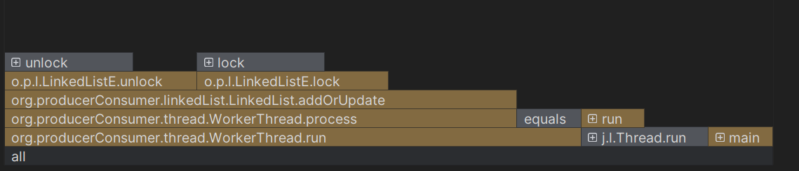
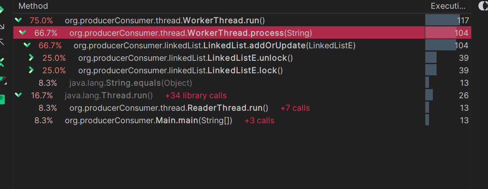
În cazul acesta durează mai mult `add` sau `update` deoarece, în primul rând, face `lock` cu `ReentrantLock` și durează pentru că trebuie să caute dacă este `update` etc.
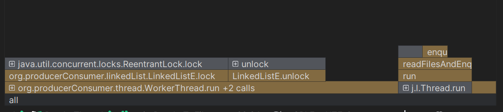
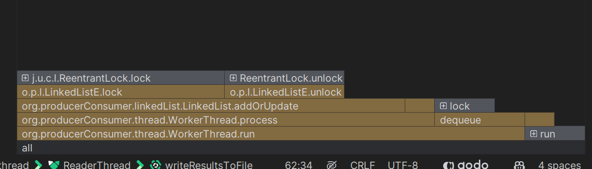 - 77.3396
Uneori timpii mai mari sunt cauzați și de coada de la queue și dequeue pentru că și pe ea avem un lock.
De asemenea, are sens ca majoritatea timpului să fie ocupate de add/update deoarece ea este operația care se face cel mai des.
Deci se întâmplă un overhead deoarece se face lock și unlock de fiecare dată când se face add/update chiar dacă este pe un singur element la un anumit timp. Mai ales la update noi luăm un nod, îl blocăm, parcurgem lista până îl găsim sau dacă nu îl găsim mergem și îl adăugăm la început blocând iarăși două noduri. Și dacă vor să se adauge de două thread-uri noduri în același timp, se blochează și se deblochează de două ori pentru fiecare nod.
De asemenea, avem 6.7% din timp ocupat de sortare și scriere în fișier!

În cazul în care blocăm toată lista, profiling arată așa:
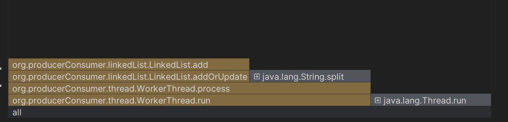
Dacă ne uităm, tot add și update ocupă cel mai mult timp:
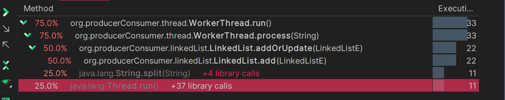

Contează foarte mult și cum procedează scheduler-ul. Uneori durează mai mult din cauza cozii, alteori din cauza lock și unlock.
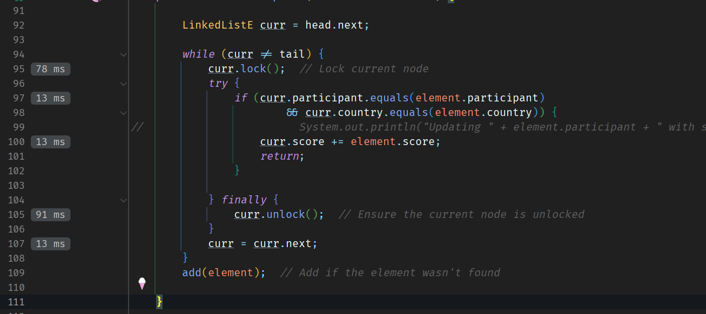
We can clearly see that the lock there takes a long time which is to be expected.

Am încercat, de asemenea, să reduc overhead-ul, în special în `addUpdate`, dar fără succes.

Timpul a devenit mai mare, apropiindu-se de versiunea secvențială.

În timpul testării cu 2 thread-uri de citire și 12 thread-uri de scriere, ne așteptăm ca timpul să fie mai mare, deoarece am doar 14 cores pe mașina mea.

Dar vedem beneficiile utilizării sincronizării fine grain. Thread-urile rulează mai mult în paralel, așa cum se vede din profilare.

Fine grained:
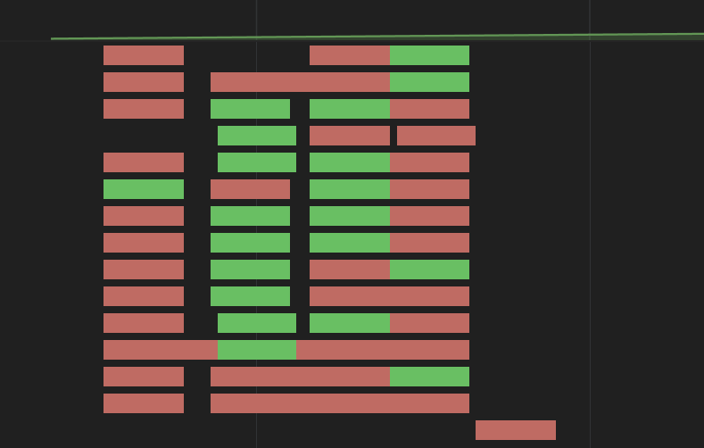
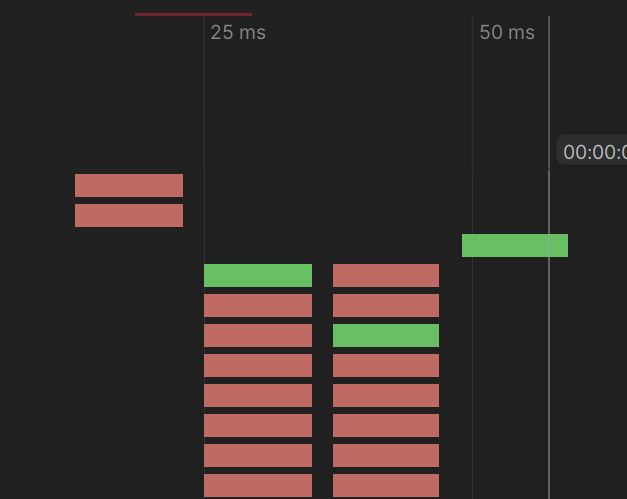

Diferența este foarte clară.
Poate în alte cazuri sincronizarea fine grain ar fi mai bună. Dar, deoarece avem o mulțime de informații pe care le adăugăm și trebuie să blocăm și să deblocăm elementele din listă, este mai bine să folosim sincronizarea coarse grain.
O mulțime de thread-uri vor încerca să adauge sau să actualizeze în același timp. De aceea, `curr.lock()` și `curr.unlock()` din `addUpdate` sunt cele mai consumatoare de timp.

La varianta B:
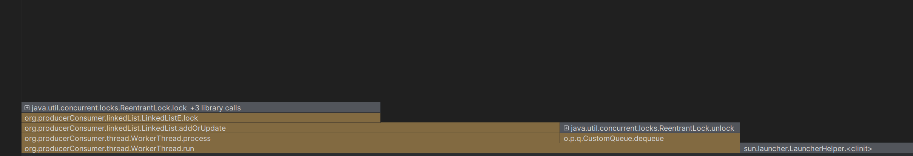
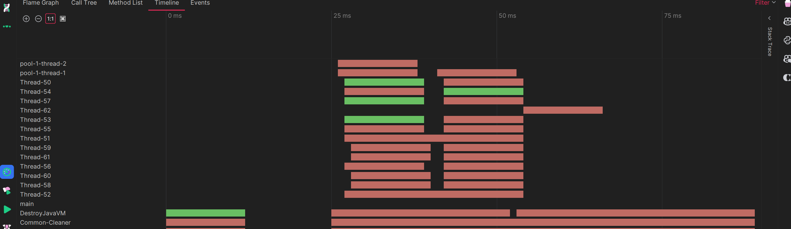
E mai randomizat felul în care thread-urile iau job-urile și le procesează.
Putem observa că tot lock și unlock ocupă cel mai mult timp.
Dar și coada își face prezența când vorbim de coada de 100.
La un număr mai scăzut ca și capacitate a cozii acțiunile se întâmplă mai în paralel.
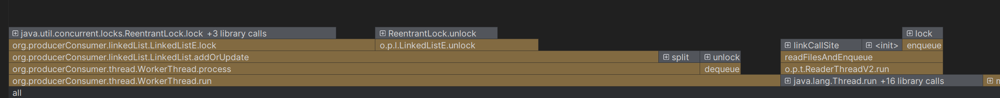
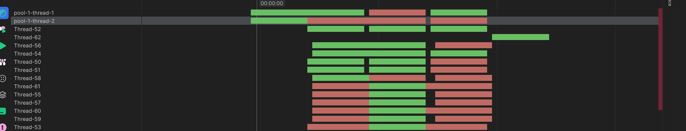

Acum la 2 readers și 8 writers:

Nu mai avem la fel de multe probleme cu lock și unlock.
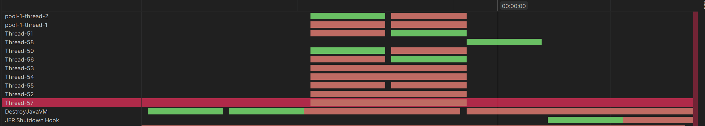

Și doar ca să vedem cum ar arăta cu 4 readers și 4 writers:
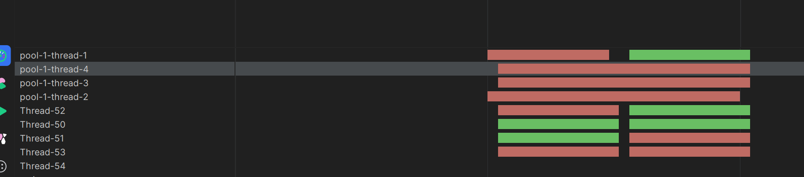
Deci în concluzie contează foarte mult cum procedează scheduler-ul și cum se întâmplă lock și unlock.

Implementarea cu sincronizare fine-grained, cel puțin pe setul nostru de date, pierde în fața celei coarse-grained. În momentul în care introducem executor service, putem observa că se apropie ca timp, dar altfel nu. Cu executor service și fine-grained pe listă, paralelizăm însă procesul și mai mult. Totuși, în cazul nostru, cu un număr mic de fișiere și date, nu se observă o diferență foarte mare. Dacă am avea un număr mai mare de fișiere și date, varianta cu 2 readers și 2 writers sau cea cu 4 readers și 2 writers ar putea fi mai eficientă.

În plus, sincronizarea fine-grained poate aduce beneficii semnificative în scenarii cu un volum mare de date și operațiuni concurente, deoarece permite o granularitate mai fină a blocărilor, reducând astfel timpul de așteptare pentru accesul la resurse partajate. Totuși, acest avantaj vine cu un cost suplimentar de complexitate în implementare și gestionare a blocărilor.

În concluzie, alegerea între sincronizarea fine-grained și coarse-grained depinde de specificul aplicației și de volumul de date procesate. Pentru seturi de date mici și medii, coarse-grained poate fi suficient și mai simplu de implementat, în timp ce pentru seturi de date mari și operațiuni intens concurente, fine-grained poate oferi performanțe mai bune, dar cu un cost de complexitate crescută.
